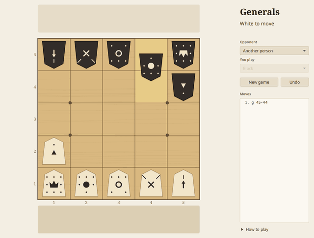
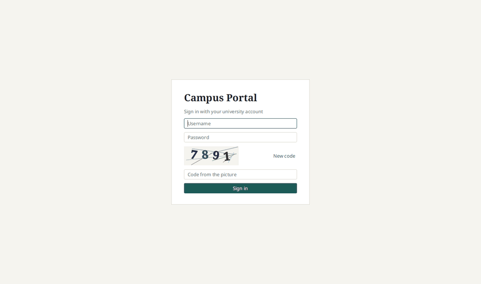

# Advanced Programming, 2022

Java projects that started as my coursework for the Advanced Programming course at Sharif University of Technology, taught by Dr. Tefagh.

| Folder | What it is | State |
|---|---|---|
| [`generals/`](generals/) | A 5×5 shogi-style board game with a JavaFX interface, a console mode and a computer opponent | Finished |
| [`campus-portal/`](campus-portal/) | A university portal with a socket server and a JavaFX desktop client | Finished |
| [`coursework/`](coursework/) | The exercises and final project as I left them in 2022, with the assignments | Archive |

## Generals

A two-player board game on a 5×5 board, close to shogi: captured pieces change sides and come back into play. Play another person or the computer at three levels.

## Campus Portal

A university system with a socket server and a desktop client. Students select courses, follow their grades, send requests and hand in coursework. Professors grade and run their course pages. Department staff manage courses and people, and everyone has a messenger.

## Building

Each project builds on its own with JDK 21. See its README for how to run it.

## Downloads

Ready-to-run builds for Windows and Linux are attached to each [release](../../releases). They include their own Java, so nothing else needs installing.

| | Windows | Linux |
|---|---|---|
| Generals | `Generals-windows.zip`, then run `Generals.exe` | `Generals-x86_64.AppImage`, or the `.deb` |
| Campus Portal | `CampusPortal-windows.zip`, then run `CampusPortal.exe` | `CampusPortal-x86_64.AppImage`, or the `.deb` |

The portal client can start a demo server on your own computer, so it works on its own. The Windows builds are not signed, so Windows may warn before opening them.

To build them yourself on Linux, run `./gradlew packageApp` in `generals` and `./gradlew :client:packageApp` in `campus-portal`, then wrap the results with `packaging/appimage.sh`.

## License

[MIT](LICENSE.md)
