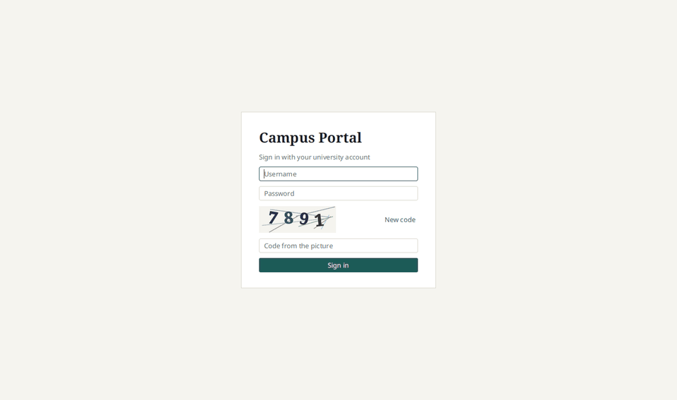

# Campus Portal

A university portal with a socket server and a JavaFX desktop client. Students select courses, follow their grades, send requests and submit coursework. Professors grade and run their course pages. Department staff manage courses and people, and everyone can message each other.



I started this in 2022 as the final project of the Advanced Programming course at Sharif University of Technology, and did not finish it then. The version I left is in [`coursework/Project`](../coursework/Project). This is a rewrite that completes the brief. [`docs/REQUIREMENTS.md`](docs/REQUIREMENTS.md) lists what the brief asked for.

## Running it

You need JDK 21. This starts the server and the client together, and stops the server when you close the client:

```sh
cd campus-portal
./run-demo.sh
```

To run them separately, use two terminals, because the server keeps running until you stop it with Ctrl+C:

```sh
./gradlew :server:run
./gradlew :client:run
```

The packaged client from the [releases](../../../releases) needs no separate server: when none is running, the login screen offers to start a demo server on your own computer.

The first start creates a local database in a `data` folder with made-up people. Every demo account uses the password `demo1234`:

| Role | Usernames |
|---|---|
| Undergraduate | `student.sara`, `student.omid`, `student.lena` |
| Master's | `student.nika`, `student.arman` |
| PhD | `student.reza`, `student.yasi` |
| Professor | `prof.karimi`, `prof.moradi` |
| Head of department | `head.cs`, `head.math` |
| Deputy | `deputy.cs`, `deputy.math` |
| Registrar | `registrar` |
| Administrator | `admin` |

`student.sara` has an open unit selection window. Passwords must be changed after three hours away, as the brief requires, but the demo accounts are reset each time the server starts.

## How it is built

```
client (JavaFX)  ──  one line of JSON per message over a socket  ──  server  ──  Hibernate  ──  H2 or MariaDB
```

- `common` holds the message format shared by both sides.
- `server` connects each request type to a handler and the roles allowed to use it. Every request runs in its own database transaction, and handlers check that the record belongs to the user.
- `client` has one window with a page per task. Pages refresh themselves every few seconds. Some are saved on disk, so home, weekly plan, exams, academic record, profile and recent messages still open when the server is away.

## Settings

| Environment variable | Default |
|---|---|
| `PORTAL_HOST` (client) | `localhost` |
| `PORTAL_PORT` | `8080` |
| `PORTAL_DB_URL`, `PORTAL_DB_USER`, `PORTAL_DB_PASSWORD` | Local H2 file |
| `PORTAL_DEMO_DATA` | `true` |

## Building and testing

```sh
./gradlew test
./gradlew :client:screenshots
./gradlew :client:packageApp
```

The server tests talk to a running server over real sockets. The client tests start the server in its own process and drive the real window without a display. `packageApp` needs a JDK that includes `jmods`.

## Limits

- Connections are not encrypted, so run it only on a network you trust.
- Attachments are downloaded rather than played inside the app.
- MariaDB should work through `PORTAL_DB_URL`, but I have only tested H2.

## License

[MIT](../LICENSE.md)
