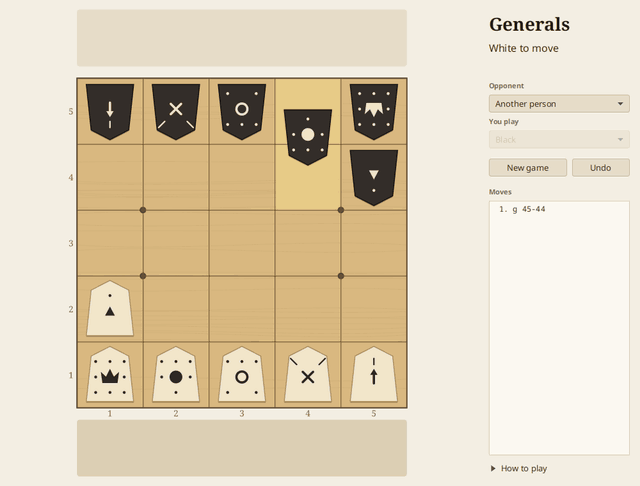
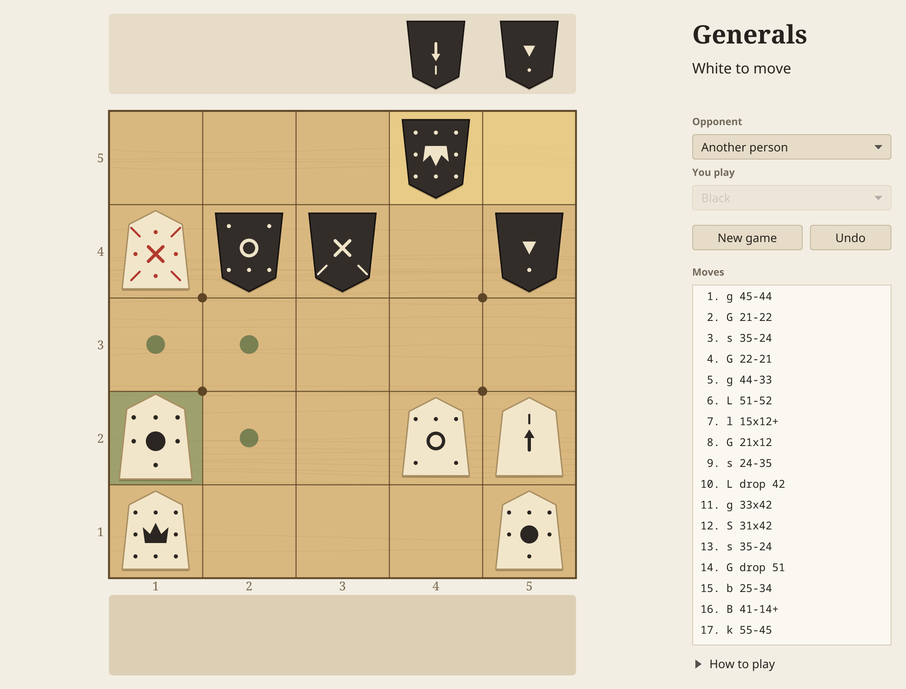

# Generals

A two-player board game on a 5×5 board, close to shogi: captured pieces change sides and can be dropped back into play. You can play another person at the same computer, or the computer at three levels.



I wrote the first version in 2022 for the Advanced Programming course at Sharif University of Technology, with a console mode and a Swing window. This is a rewrite of it. The original is in [`coursework/exercise_3`](../coursework/exercise_3).

## Running it

You need JDK 21.

```sh
cd generals
./gradlew run
```

Shortcuts: `Ctrl+Z` undoes a move and `Ctrl+N` starts a new game.

## Rules

Black moves first. You win by capturing the enemy king. There is no check or checkmate, so a king can be left under attack, and the game shows a red frame around it when that happens.

| Piece | Moves | After upgrading |
|---|---|---|
| King | One square in any direction | Does not upgrade |
| Golden general | One square, except diagonally backward | Does not upgrade |
| Silver general | One square forward or diagonally | Up to two squares in any direction |
| Bishop | Any distance diagonally forward | Any distance diagonally, or one square straight |
| Lance | Any distance forward | Any distance straight |
| Pawn | One square forward | Moves like a golden general |

- Pieces cannot jump.
- A piece upgrades when it ends a move in the two rows nearest the enemy.
- A captured piece goes to your hand and loses its upgrade. On a later turn you can drop it on any empty square.
- A piece dropped in those two rows does not upgrade on landing. It upgrades if it later ends a move there. A pawn, lance or bishop dropped on the very last row can never move, because those pieces only go forward.

The marks on each tile show how it moves: a dot is one step, two dots are up to two steps, and a line is any distance.



## Console version

The original text interface still works:

```sh
cd generals
./gradlew installDist
build/install/generals/bin/generals-console
```

A move is `Piece From To`, with columns and rows numbered from the bottom left. White pieces are upper case and Black pieces lower case, so `p 54 53` moves Black's pawn. Use `00` as the origin to drop a piece, and `0` to quit. After each line the program prints the board, then Black's hand, then White's.

## What changed since 2022

- The rules moved out of static fields into a `Game` object that can be copied, which made testing and the computer player possible.
- The Swing window was replaced by a resizable JavaFX one with dragging, move highlights, undo and a move list.
- The piece images were replaced by tiles drawn in code.
- The computer player is new. It uses alpha-beta search. Easy and Normal search a fixed depth with some randomness, and Hard searches for about a second.

To check the rewrite, I recorded 40 games from the 2022 program, and the tests replay them against the new console. I also compared the two programs once on about 340,000 illegal moves, and they agreed on all of them.

## Building

```sh
./gradlew test
./gradlew packageApp
./gradlew screenshots
```

`packageApp` needs a JDK that includes `jmods`. On Fedora that is the `java-21-openjdk-jmods` package. Add `-PpackageType=deb` or another `jpackage` type to build an installer.

## Limits

- The rules have no draw or repetition rule, so a game can go on for as long as the players keep it going.
- There is no network play.
- Packaged builds are not signed, so Windows and macOS will warn when opening them.

## License

[MIT](LICENSE)
